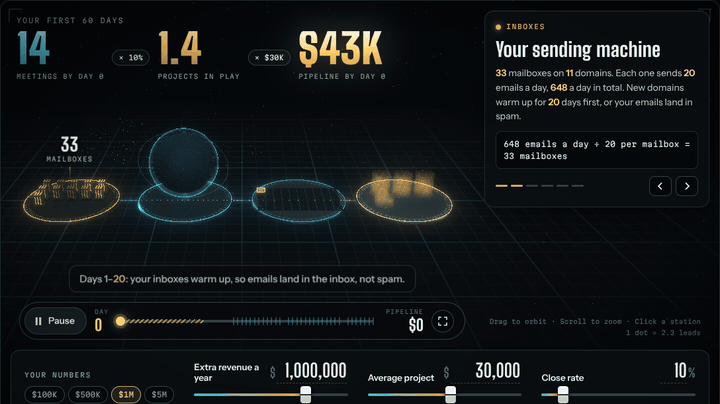
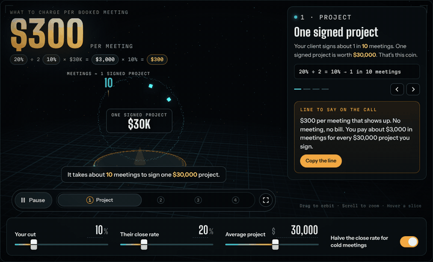

# Zayaneflow Tools

Free sales tools for cold email agencies. Built to be shown on a sales call.

**Live:** https://zayaneflow-tools.netlify.app

| Tool | 3D version | Light version |
|---|---|---|
| 60-Day Booked Meetings Planner | [/planner/](https://zayaneflow-tools.netlify.app/planner/) | [/planner-lite/](https://zayaneflow-tools.netlify.app/planner-lite/) |
| 2-Second Meeting Pricer | [/pricer/](https://zayaneflow-tools.netlify.app/pricer/) | [/pricer-lite/](https://zayaneflow-tools.netlify.app/pricer-lite/) |





## What each tool does

**60-Day Booked Meetings Planner.** Type a client's extra revenue goal for the next 12 months, their average project price and their close rate. It shows the mailboxes, domains, leads and booked meetings that goal takes, and what lands in the first 60 days.

- Projects a year = revenue goal ÷ project price
- Meetings a month = projects a year ÷ 12 ÷ close rate
- Interested replies a month = meetings ÷ 33% (replies that book a call)
- Leads a month = interested replies ÷ 1% (interested reply rate)
- Emails a month = leads × 2 (sequence steps); mailboxes = emails a day ÷ 20; domains = mailboxes ÷ 3
- First 60 days: 20 days of inbox warm-up, first meetings about 5 days after the first send

Every benchmark can be changed in the page.

**2-Second Meeting Pricer.** Price per booked meeting = your cut × (their close rate ÷ 2) × their average project. Cold meetings sign less often than referrals, so the close rate is halved (you can switch that off). Per signed project, the client pays your cut of the project value in meetings and keeps the rest.

## Run it yourself

Each page is one self-contained HTML file: open it in a browser. three.js 0.147 and GSAP 3.12 load from jsDelivr and cdnjs. No build step, no API keys, no backend.

```
index.html              landing page
planner/index.html      60-Day Booked Meetings Planner (3D)
pricer/index.html       2-Second Meeting Pricer (3D)
planner-lite/           light versions without the 3D view
pricer-lite/
media/                  previews (GIF, MP4, PNG)
source/                 templates + build scripts (see source/README.md)
```

6 languages (English, French, Spanish, German, Portuguese, Italian) and every currency.

Made by Zayane (Zayaneflow).
